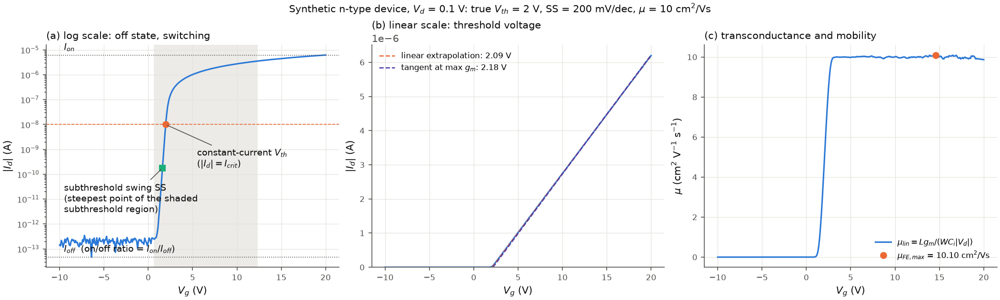

# transistor-iv-analysis

[](https://github.com/iverydj/transistor-iv-analysis/actions/workflows/ci.yml)

`transistor_iv` is a Python package that extracts threshold voltage, subthreshold swing,
on/off ratio, transconductance, mobility, hysteresis and trap densities from transistor
transfer and output curves. It is written for researchers who measure thin-film and
2D-material transistors (oxide semiconductors, MoS2, ...) and want transparent, documented
extraction methods they can apply to their own data: Keithley 4200A-SCS Clarius `.xls`
exports are read directly, anything else via CSV files or arrays, and n- and p-type devices
are handled by one explicit polarity convention.

Every method is documented with its definition and units, the exact algorithm, its
parameters, when it is valid and its pitfalls, and every result carries the information
needed to check it (fit windows, regions, point-wise curves, reasons for missing values).



*A synthetic transfer curve and where the main quantities come from: (a) off and on current,
subthreshold region and swing, constant-current threshold; (b) linear extrapolations of the
threshold voltage; (c) the linear mobility from the transconductance and its maximum.*

## What it extracts

* **Threshold voltage**: the six methods of the original scripts (constant current, linear
  fit next to the subthreshold region, best linear window, maximum log slope, second
  derivative, square-root extrapolation) plus the tangent at maximum g_m; optional V_d/2
  correction ([docs](docs/threshold_voltage.md)).
* **Subthreshold swing**: point-wise minimum in the subthreshold region (with a 60 mV/dec
  floor by default), shortest decade, or a stated current window ([docs](docs/subthreshold_swing.md)).
* **Transconductance and on/off ratio**: smoothed g_m, I_on, I_off ([docs](docs/transconductance_and_on_off.md)).
* **Mobility**: linear (field-effect), effective and saturation mobility, mu_sat from the
  square-root fit, mu_FE at a stated gate voltage ([docs](docs/mobility.md)).
* **Hysteresis and traps**: sweep splitting, threshold shift for every method, trapped-charge
  density N_trap, loop area, interface-trap density D_it from SS ([docs](docs/hysteresis_and_traps.md)).
* **Output curves**: figures, contact-symmetry score, low-bias resistance ([docs](docs/output_curves.md)).
* **Batch processing**: one table for many curves and files, per-device geometry
  ([docs](docs/batch_processing.md)).
* **Input**: Clarius `.xls`, `Conditions.xls` geometry tables, CSV ([docs](docs/input_formats.md));
  **conventions**: polarity, units, sweep segments ([docs](docs/polarity_and_units.md)).

Full documentation: [docs/index.md](docs/index.md). Example scripts and what their outputs
look like: [docs/examples.md](docs/examples.md).

## Install

```bash
pip install git+https://github.com/iverydj/transistor-iv-analysis.git
```

Python >= 3.10 with numpy, scipy, pandas, matplotlib and xlrd. For development:

```bash
git clone https://github.com/iverydj/transistor-iv-analysis.git
cd transistor-iv-analysis
pip install -e ".[test]"
pytest
```

## Minimal usage

```python
import transistor_iv as tiv
from transistor_iv import plot

# W/L = 100/10 um on 100 nm SiO2, n-type
dev = tiv.Device.from_dielectric(width_um=100, length_um=10, eps_r=3.9, thickness_nm=100, polarity="n")

curve = tiv.read_clarius_transfer("examples/data/TC_example2.xls")[0]   # or tiv.read_transfer_csv("my.csv")
res = tiv.analyze_transfer(curve, dev)                                   # settings: tiv.TransferSettings()

print(res.vth_current, res.vth_global)                # V; V_d = 10 V here: no saturation method
print(res.ss, res.on_off, res.mu_fe_max)               # mV/dec, -, cm^2/(V s)
print(res.fits["vth_global"].v_range, res.notes)       # where the line was fitted; notes on missing or doubtful values
plot.plot_analysis(res).savefig("analysis.png")
```

Many curves: `tiv.analyze_curves`, `tiv.summary_table`, `tiv.write_tables`; dual sweeps:
`tiv.analyze_hysteresis`; output curves: `tiv.read_clarius_output`, `tiv.summarize_output`.
The scripts in [`examples/`](examples) are configured by an `AppConfig` block at their top.

## Origin

The transfer-curve methods and their default selection rules are those of the author's
analysis scripts for Clarius exports; the differences (bug fixes, options, additions) are
listed in [docs/changes_from_original.md](docs/changes_from_original.md).

## Citation

If this package is useful in your work, please cite it (see [`CITATION.cff`](CITATION.cff)):

```bibtex
@software{yi_transistor_iv_analysis,
  author  = {Yi, Dong-Joon},
  title   = {transistor-iv-analysis: parameter extraction from transistor I-V curves},
  version = {1.0.0},
  year    = {2026},
  url     = {https://github.com/iverydj/transistor-iv-analysis}
}
```

## License

MIT, see [`LICENSE`](LICENSE).
