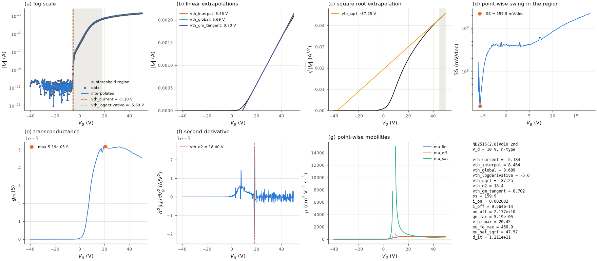
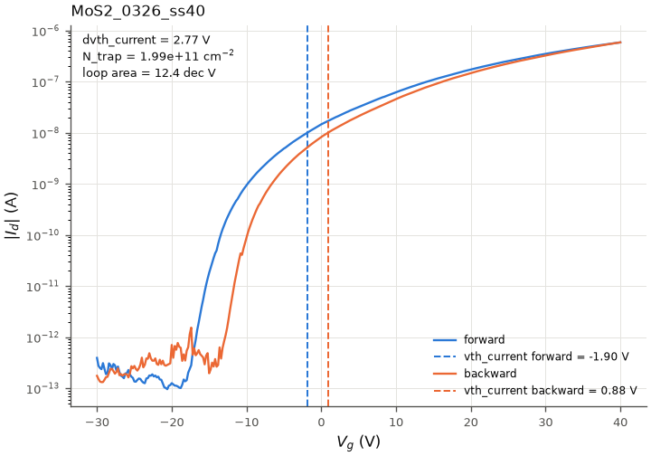
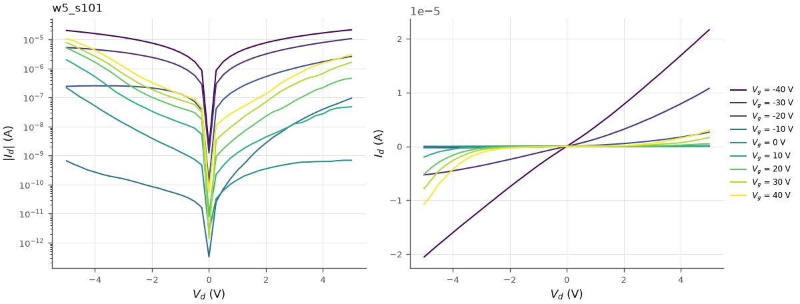

# Worked examples

The scripts in [`examples/`](../examples) run on the bundled files in `examples/data/`
([input formats](input_formats.md#bundled-example-files)). Each is configured by an
`AppConfig` dataclass at its top: edit it and run the file, e.g.

```bash
python examples/analyze_clarius_file.py
```

Outputs go to `examples/output/<script>/`. The geometry of the example devices is not
stored in the files (except for `TC_example1.xls`) and no dielectric constant is; the
scripts assume W = L = 5 um on 300 nm SiO2 where needed, so **every mobility below is an
illustration of the output format, not a device result.** The excerpts were produced with
the versions in `environment.yml`.

| script | input | what it shows |
|---|---|---|
| `analyze_clarius_file.py` | `TC_example2.xls` | every sheet of a Clarius file: table, CSV tables, one analysis figure per curve |
| `analyze_csv.py` | `transfer_example.csv` | one CSV curve: every scalar, the fit windows, the notes |
| `hysteresis_example.py` | `TC_example5.xls` | dual sweeps: threshold shift, N_trap, loop area |
| `output_curves_example.py` | `OP_ex1.xls`, `OP_ex2.xls` | output families: figures, symmetry, R_on |
| `batch_summary.py` | `TC_example1.xls` + `Conditions.xls`, `TC_example2.xls` | several files, per-sheet geometry, one table |
| `synthetic_demo.py` | synthetic model | what each method returns for a device with known parameters |

## One Clarius file: `analyze_clarius_file.py`

Excerpt of the printed table (V in V, SS in mV/dec, mu in cm²/Vs):

```text
               name  v_d  vth_current  vth_interpol  vth_global  vth_gm_tangent  vth_sqrt    ss    on_off  mu_fe_max  mu_sat_sqrt
ND2515(2,6)Vd10 2nd   10       -5.184         8.464       8.689           8.702    -37.25 159.9 2.177e+10      450.9        47.57
ND4000(2,4)Vd10 3rd   10       -9.326        -1.801       4.377           4.479    -7.657 82.82 1.871e+10      526.5        313.5
ND3010(2,3)Vd10 3rd   10       -3.711         10.13       10.86           10.91     3.221 77.12 9.317e+09      445.4        328.3
...
ND0040(2,5)Vd10 3rd   10        9.323         24.18        26.4           26.45     14.86 295.2 6.138e+09        103        45.52
```

The reader warns that one sheet's Settings block says V_d = 20 V while its DrainV column
says 10 V (the column is used). The figure of the first sheet:



*`plot_analysis(result)` for `ND2515(2,6)Vd10 2nd`. What to read from it:
(a) the constant-current V_th (-5.2 V) and the steepest subthreshold point (-5.6 V) lie
at the exit from the noise floor; (b) the three linear extrapolations agree within 0.3 V;
(c) `vth_sqrt` = -37 V: at V_d = 10 V the device is not saturated over most of the sweep,
and the most linear sqrt window is at the end of the sweep, so this value has no meaning
here; (d) SS = 160 mV/dec at the start of the subthreshold region; (f) the unsmoothed
second derivative peaks on a single spike (18.4 V), so `vth_d2` is not usable for this
curve without `d2_window`; (g) the point-wise mu_sat diverges at `vth_interpol`.*

## A CSV curve: `analyze_csv.py`

`transfer_example.csv` is the first sheet of `TC_example2.xls` written by
`write_transfer_csv`. Output (excerpt):

```text
transfer_example: 566 points, V_d = 10 V, segment -40 -> 50 V
  vth_current        -5.1835
  vth_interpol        8.4637
  vth_global          8.6892
  vth_logderivative  -5.6
  vth_sqrt           -37.246
  vth_d2              18.4
  vth_gm_tangent      8.7025
  ss                  159.86
  on_off              2.1771e+10
  mu_fe_max           450.89
  d_it                1.2109e+11
  fit vth_interpol    V_g 21.75 .. 26.70 V, r = 1.000000
  fit vth_global      V_g 28.70 .. 33.50 V, r = 0.999999
  fit vth_sqrt        V_g 45.20 .. 50.00 V, r = 0.999916
```

The fit windows show where each extrapolation was made: the sqrt window at the very end
of the sweep is the warning sign for `vth_sqrt`.

## Dual sweeps: `hysteresis_example.py`

Each sheet of `TC_example5.xls` is a ramp 0 -> -30 V followed by -30 -> 40 -> -30 V, so the
forward and backward branches are segments 1 and 2:

```text
segments of the first curve: [(0.0, -30.0), (-30.0, 40.0), (40.0, -30.0)]
          name  vth_current_fwd  vth_current_bwd  dvth_current  n_trap_current  ss_fwd  ss_bwd  loop_area
MoS2_0326_ss40           -1.895           0.8794         2.775       1.994e+11    1145    1089      12.36
MoS2_0326_ss39          -0.4779            2.642          3.12       2.241e+11   787.3    1243      13.31
...
      vth_current_fwd  vth_current_bwd  dvth_current  n_trap_current  ss_fwd  ss_bwd  loop_area
mean           -3.509           -1.213         2.296       1.649e+11   775.6    1102      9.667
std             5.251            5.617        0.5901       4.239e+10   408.2   264.7       2.41
```



*Forward and backward branches of `MoS2_0326_ss40` with the constant-current thresholds
(10 nA). The positive shift (clockwise loop) indicates electron trapping during the forward
sweep. The point-wise SS values of these gradual MoS2 curves are large and differ between
branches; on such curves report SS with an explicit current window
(`ss_method="current_window"`).*

## Output curves: `output_curves_example.py`

```text
OP_ex1.xls w4_s102_r1: 9 curves, mean symmetry 71.9 %
OP_ex1.xls w5_s103: 9 curves, mean symmetry 41.2 %
OP_ex1.xls w5_s101: 9 curves, mean symmetry 22.8 %
OP_ex2.xls w1_s102: 9 curves, mean symmetry 82.4 %
OP_ex2.xls w1_s101: 9 curves, mean symmetry 80.8 %
      name  v_g   i_d_max  symmetry      r_on       file
w4_s102_r1  -40 3.947e-05     46.11 8.001e+05 OP_ex1.xls
w4_s102_r1  -30 3.874e-05     73.18  3.47e+06 OP_ex1.xls
...
```



*`plot_output(family)` for `OP_ex1.xls`, sheet `w5_s101`.*

## Several files: `batch_summary.py`

```text
median per file:
                 vth_current  vth_global    ss    on_off  mu_fe_max
file
TC_example1.xls        2.868        9.51 159.7 6.131e+08      499.6
TC_example2.xls       -2.394       9.882 151.8 1.773e+10      443.3
```

Writes `all_results.csv` and, per file, the four tables of
[batch processing](batch_processing.md).

## Known answers: `synthetic_demo.py`

A model device (V_th = 2 V, SS = 200 mV/dec, mu = 10 cm²/Vs; n-type and its p-type mirror)
at V_d = 0.1 V and 20 V, exact and with 0.3 % noise:

```text
 noise polarity     regime  vth_current  vth_interpol  vth_global  vth_logderivative  vth_sqrt  vth_d2  vth_gm_tangent      ss  mu_fe_max  mu_sat_sqrt
 0.000        n     linear        1.956         2.050       2.050              1.600   -13.356   2.100           2.050 201.088     10.000        0.032
 0.000        n saturation        1.917         9.707       9.707              1.500     1.998  18.700          10.999 200.796      9.000        9.999
 0.000        p     linear       -1.956        -2.050      -2.050             -1.600    13.356  -2.100          -2.050 201.088     10.000        0.032
 0.003        n     linear        1.956         2.052       2.099              1.600   -13.434  12.100           2.959 200.655     10.580        0.032
 0.003        n saturation        1.917         8.890       9.701              1.600     1.988  19.100          11.085 200.386      9.119        9.961
 ...
```

Read row by row: in the linear regime the linear extrapolations give V_th + V_d/2 = 2.05 V
exactly and mu_fe_max = 10.000; in saturation only `vth_sqrt` and `mu_sat_sqrt` recover the
model (and the "linear" mobility is 0.9 mu, the value of the linear formula at the end of a
saturated sweep); with noise, `vth_d2` and `vth_gm_tangent` move most, as discussed in
[threshold voltage](threshold_voltage.md).
