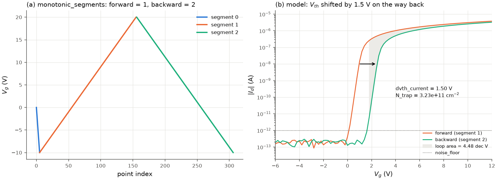

# Hysteresis and trap densities

## Dual sweeps

`analyze_hysteresis(curve, device, settings, segments=None, noise_floor=1e-12)` analyses
a transfer curve swept forward and back:

1. **Splitting.** `monotonic_segments(v_g)` cuts the sweep at every reversal (a turning
   point belongs to both neighbours; a repeated point separates them).
   `split_dual_sweep(v_g, segments)` returns the forward and backward branches: by
   default the sweep must have exactly two segments; otherwise give their numbers, e.g.
   `segments=(1, 2)` for 0 -> -30 -> 40 -> -30 V, whose segment 0 is the ramp to the start
   value (the bundled `TC_example5.xls`).
2. **Both branches** are analysed with `analyze_transfer` and the same settings
   (`HysteresisResult.forward`, `.backward`).
3. **Threshold shift** for each of the seven [threshold-voltage methods](threshold_voltage.md):

   $$\Delta V_{th} = V_{th}(\text{backward}) - V_{th}(\text{forward}) \quad (\text{V}),$$

   `HysteresisResult.dvth["vth_current"]`, ...
4. **Trapped-charge density** for each method:

   $$N_{trap} = \frac{C_i\, \Delta V_{th}}{q} \quad (\text{cm}^{-2}),$$

   signed (`n_trap_from_dvth`), the areal density of charge that would shift the
   threshold by Delta V_th if it sat at the semiconductor/insulator interface.
5. **Loop area** (`loop_area`):

   $$A = \int \left[\log_{10}|I_{fwd}| - \log_{10}|I_{bwd}|\right] dV_g \quad (\text{dec V}),$$

   evaluated on the forward branch's V_g points within the range common to both branches
   (the backward log current interpolated linearly there), over the points where both
   currents exceed `noise_floor` (default 1e-12 A), with the trapezoidal rule.
   A > 0 when the forward branch carries more current.

*(a) A sweep 0 -> -10 -> 20 -> -10 V split into its three segments. (b) Model device whose
threshold is 1.5 V higher on the way back: the constant-current shift is 1.50 V, i.e.
N_trap = 3.23e11 cm⁻² on 100 nm SiO2; the shaded area between the branches above the noise
floor is the loop area, 4.48 dec V.*

**Signs.** For an n-type device swept up first, Delta V_th > 0 and A > 0 mean that the
backward branch carries less current: negative charge (electrons) was trapped during the
forward sweep, a clockwise loop in the I_d-V_g plane. For a p-type device swept from the
off state towards negative V_g first, trapped holes make the backward threshold more
negative: Delta V_th < 0 and A > 0. Mobile ions or ferroelectric-like polarisation give the
opposite sense.

**Pitfalls.**

* Delta V_th depends on the method; the constant-current shift is the most robust, the
  second-derivative and log-slope shifts the least. Report the method.
* Hysteresis depends on sweep range, rate, delay and history; compare only identical
  measurement settings.
* N_trap assumes the trapped charge at the interface; charge inside the insulator at a
  distance x from the gate needs C_i scaled by t_i / x. It is a lower bound for the trap
  density (only traps that change occupation during the sweep count).
* The loop area depends on `noise_floor` and on the V_g range; crossing (figure-eight)
  loops give partly cancelling contributions.

## Interface-trap density from SS

`TransferResult.d_it` (cm⁻² eV⁻¹), from `d_it_from_ss(ss, c_i, temperature)`:

$$SS = \ln(10)\frac{k_B T}{q}\left(1 + \frac{C_{it}}{C_i}\right), \qquad C_{it} = q D_{it}$$

$$\Rightarrow\quad D_{it} = \frac{C_i}{q}\left[\frac{SS}{\ln(10)\, k_B T/q} - 1\right],$$

with SS in V/dec in the bracket (the function takes mV/dec), C_i in F/cm²,
q = 1.602e-19 C and T = `TransferSettings.temperature` (300 K). At 300 K
ln(10) k_B T/q = 59.5 mV/dec; for SS = 200 mV/dec on 34.5 nF/cm² (100 nm SiO2)
D_it = 5.1e11 cm⁻² eV⁻¹. Below the thermionic limit the formula does not apply and
`d_it` is NaN with a note.

**Pitfalls.** The depletion capacitance of the semiconductor is neglected (adequate for
thin, fully depleted channels such as oxide TFTs and 2D materials; otherwise D_it is an
upper bound). D_it inherits every uncertainty of SS ([subthreshold_swing.md](subthreshold_swing.md)):
the selection rule, the noise and the sampling. It is an average over the energies swept by
the Fermi level in the subthreshold region.
