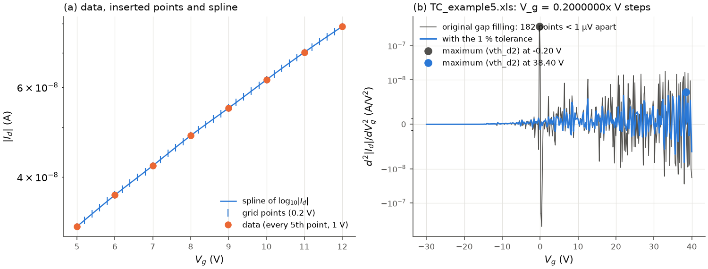

# The interpolated curve (shared preprocessing)

All transfer-curve methods except the constant-current threshold and the on/off
ratio work on one smooth, finely sampled version of the measured sweep. It is built
once per curve by `transistor_iv.transfer.interpolate_curve` (called by
`analyze_transfer`) and stored in `TransferResult.curve`.

## Algorithm

1. **One monotonic segment.** The analysed segment (`TransferSettings.segment`, see
   [polarity and units](polarity_and_units.md#sweeps-and-segments)) is put in the
   on-direction frame u = s V_g (s = +1 for n-type, -1 for p-type), so that the current
   increases with u. Repeated V_g values are dropped (the first one is kept).
2. **Spline of the log current.** log10|I_d| (with |I_d| clipped at 1e-20 A) is
   interpolated with a cubic smoothing spline,
   `scipy.interpolate.UnivariateSpline(u, log10|I_d|, s=spline_smoothing)`.
   With the default `spline_smoothing = 0` the spline passes exactly through every
   measured point.
3. **Evaluation grid.** The spline is evaluated at the measured points plus points
   inserted into every gap wider than `grid_step` (default 0.2 V), at multiples of
   `grid_step` from the left end of the gap. A 0.25 V gap gets one point (+0.2 V), a
   1 V gap four. Data measured with steps of 0.2 V or less are used as they are.
4. **Derived arrays.** I = 10^spline on the grid, and the log slope

   $$\frac{d\log_{10}|I_d|}{du} \quad (\text{dec/V}),$$

   computed with `np.gradient` and set to 1e-12 dec/V wherever it is not positive.

*(a) Every fifth point of a measured MoS2 sweep (1 V steps) with the inserted 0.2 V grid
points and the spline. (b) Second derivative of the full sweep (0.2 V steps stored in
single precision): without a tolerance the gap filling inserts a point within 1 µV
of 182 of the 351 measured points, and the round-off of these pairs dominates
d²I/dV_g² (its maximum, the second-derivative threshold, lands at -0.2 V). With the 1 %
tolerance the grid is the data itself. Script: `figures/make_interpolation.py`.*

## Parameters

| `TransferSettings` field | default | meaning |
|---|---|---|
| `grid_step` | 0.2 V | largest spacing of the evaluation grid; `None` evaluates at the data points only |
| `spline_smoothing` | 0.0 | `s` of `UnivariateSpline` on log10\|I_d\|; 0 = exact interpolation |

## Window lengths on the grid

The window-based methods specify windows in volts (`linear_window` = 5 V,
`linear_extension` = 3 V). A window of w volts is the run of
floor(w / mean grid spacing) consecutive grid points (at least 3 for the fit windows).
On a uniform 0.2 V grid a 5 V window is 25 points, i.e. it spans 4.8 V from the first
to the last point. On a non-uniform grid (0.25 V data give alternating 0.2 V and
0.05 V spacings) the mean spacing keeps the window close to w volts.

## Pitfalls

* **Exact interpolation keeps the noise.** With `spline_smoothing = 0` every noise
  spike of the data is in the spline; first derivatives (log slope, g_m) and especially
  second derivatives inherit it. Remedies: `spline_smoothing > 0` (acts on log10|I_d|,
  the scale is the sum of squared residuals in decades), the derivative windows
  `gm_window` and `d2_window`, or the window-free methods.
* **Single-precision voltages.** Instruments often store V_g in single precision
  (0.2 V becomes 0.2000000x V). Gaps that exceed a multiple of `grid_step` by less than
  1 % of a step are therefore not split (see the figure).
* **Non-uniform list sweeps.** If the step changes along the sweep, a window holds a
  fixed number of grid points and covers a different voltage span in the coarse and
  the fine parts.
* **Exact zeros.** |I_d| = 0 becomes 1e-20 A in the spline; a single zero produces a
  deep notch in the log curve. Remove such points or use a current floor before the
  analysis.
