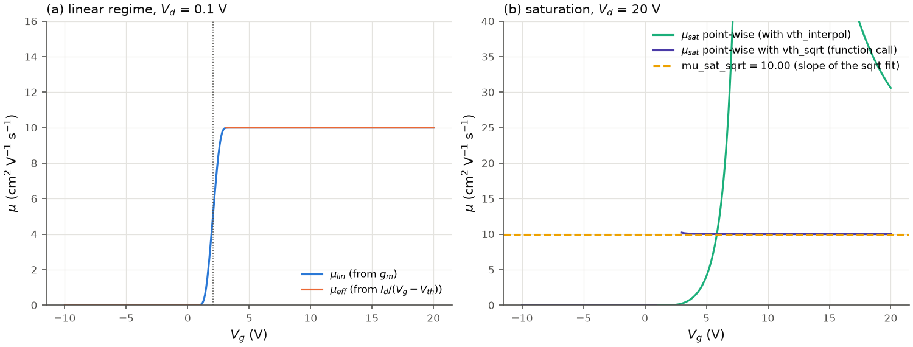

# Field-effect mobility

All mobilities are in cm²/(V s). W and L enter only as W/L (both in um), C_i is in
F/cm² (`Device.c_i`, from `gate_capacitance(eps_r, thickness_nm)`), currents in A,
voltages in V. |V_d| is used, so the formulas hold for both polarities. They all assume
the long-channel gradual-channel model: gate-voltage-independent mobility and C_i, and no
contact resistance.

| result / function | formula | regime |
|---|---|---|
| `mu_fe_max`, `curves["mu_lin"]`; `linear_mobility(gm, v_d, device)` | mu_lin = L g_m / (W C_i \|V_d\|) | linear |
| `curves["mu_eff"]`; `effective_mobility(v_g, i_d, vth, v_d, device)` | mu_eff = L \|I_d\| / (W C_i \|V_d\| \|V_g - V_th\|) | linear |
| `curves["mu_sat"]`; `saturation_mobility(v_g, i_d, vth, device)` | mu_sat = 2 L \|I_d\| / (W C_i (V_g - V_th)²) | saturation |
| `mu_sat_sqrt`; `saturation_mobility_from_slope(b, device)` | mu_sat = 2 L b² / (W C_i), b = d sqrt\|I_d\| / dV_g | saturation |
| `fe_mobility_from_sqrt_fit(b, vth, v_g, v_d, device)` | mu_FE = 2 L b² \|V_g - V_th\| / (W C_i \|V_d\|) | see below |

## Linear (field-effect) mobility, `mu_fe_max`

From I_d = (W C_i mu / L)(V_g - V_th - V_d/2) V_d in the linear regime,
g_m = (W C_i mu / L) V_d, hence

$$\mu_{lin}(V_g) = \frac{L\, g_m(V_g)}{W C_i |V_d|}.$$

`curves["mu_lin"]` is this point-wise curve with the [transconductance](transconductance_and_on_off.md)
on the interpolated grid (smoothed over `gm_window`, default 1.6 V);
`mu_fe_max` is its maximum (the original scripts' "u_FE(max)") at `v_gm_max`.

## Effective mobility, `curves["mu_eff"]`

$$\mu_{eff}(V_g) = \frac{L\,|I_d|}{W C_i |V_d|\,|V_g - V_{th}|},$$

with V_th = `vth_interpol` and NaN where |V_g - V_th| <= `min_overdrive` (1 V), where
the expression diverges. (Point-wise, as in the original scripts; the V_d/2 term of the
linear-regime current is neglected.)

## Saturation mobility

Point-wise, `curves["mu_sat"]`:

$$\mu_{sat}(V_g) = \frac{2L\,|I_d|}{W C_i (V_g - V_{th})^2},$$

with V_th = `vth_interpol`, NaN where |V_g - V_th| <= 1 V.

From the square-root fit, `mu_sat_sqrt`: with b the slope of the line through
sqrt|I_d| found by [`vth_sqrt`](threshold_voltage.md#square-root-extrapolation-vth_sqrt),

$$\mu_{sat} = \frac{2L\, b^2}{W C_i},$$

independent of V_th and averaged over the fit window.

*(a) Linear regime (V_d = 0.1 V): mu_lin and mu_eff of the model device (mu = 10 cm²/Vs).
(b) Saturation (V_d = 20 V): `mu_sat_sqrt` recovers 10.00; the point-wise mu_sat with
`vth_interpol` (a linear-regime extrapolation, 9.7 V on this saturated curve) diverges
near it, while the same formula with `vth_sqrt` (a function call:
`saturation_mobility(v, i, result.vth_sqrt, device)`) is flat at 10.*

## mu_FE at a stated gate voltage from a square-root fit

`fe_mobility_from_sqrt_fit(b, vth, v_g, v_d, device)`: if sqrt|I_d| = b (V_g - V_th) over
the fitted range, then g_m = 2 b² (V_g - V_th) and the linear-regime field-effect mobility
at V_g is

$$\mu_{FE}(V_g) = \frac{2L\, b^2\, |V_g - V_{th}|}{W C_i |V_d|}.$$

This is for devices whose current is quadratic in V_g although they are in the linear
regime (small |V_d|), as in 2D-material FETs whose mobility grows with the carrier
density: g_m then keeps rising to the end of the sweep and `mu_fe_max` is just its last
point, while the fitted g_m at a stated V_g is well defined and noise-free. Take b and
V_th from `result.fits["vth_sqrt"]` (`slope`, `vth`) or from an explicit fit range.

## Validity and pitfalls

* **Regime.** mu_lin and mu_eff need |V_d| << V_g - V_th; mu_sat needs
  |V_d| >= |V_g - V_th|. `analyze_transfer` computes every formula for every curve;
  choosing the one that matches the measurement is the user's job.
  `TransferSettings(diagnostics=True)` adds `flag_linear_regime` and `flag_saturation`
  (see [api.md](api.md#diagnostics--transistor_ivdiagnostics)). This is listed for the author's decision in
  [changes_from_original.md](changes_from_original.md).
* **Mixed regimes.** The point-wise mu_eff and mu_sat use `vth_interpol`, a linear-regime
  extrapolation (figure, panel b).
* **Maximum of a noisy curve.** `mu_fe_max` is a maximum: noise raises it, see
  [transconductance](transconductance_and_on_off.md).
* **Contact resistance** lowers g_m and the apparent mobility; **gate-dependent mobility**
  (a g_m that keeps rising) and **non-ideal C_i** (trap or quantum capacitance, thick
  semiconductor) make the extracted value a model parameter, not a material property.
  Severe overestimates of this kind are discussed in H. H. Choi et al., *Critical
  assessment of charge mobility extraction in FETs*, Nat. Mater. 17, 2 (2018).
* **Geometry and C_i.** The mobility is proportional to L / (W C_i): check the units
  (um, F/cm²) and the dielectric constant. The bundled example files carry no dielectric
  constant; their mobilities in the examples are illustrations, not device results.
* **Unknown drain bias.** Without V_d the linear-regime mobilities are NaN (with a note).
