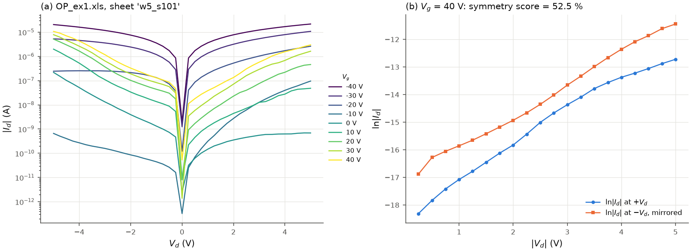

# Output curves

Output curves are I_d(V_d) sweeps at a set of fixed gate voltages. They are read as an
`OutputFamily` (`read_clarius_output` for Clarius files with numbered columns
`DrainI(n)`, `DrainV(n)`, `GateV(n)`, or `read_output_csv`; see
[input formats](input_formats.md)): `family.v_g[k]` is the gate voltage of curve k (the
mean of its `GateV(n)` column), `family.v_d[k]` and `family.i_d[k]` its sweep.

## Figures

`plot_output(family)`: |I_d| on a log axis (leakage, on/off behaviour, rectification) and
I_d on a linear axis with its sign (saturation, symmetry), coloured by V_g.

*(a) Bundled `OP_ex1.xls`, sheet `w5_s101`: an ambipolar device swept from -5 to 5 V at
nine gate voltages. (b) The construction of the symmetry score for the 40 V curve: ln|I_d|
at positive V_d and at the mirrored negative V_d (52.5 %).*

## Symmetry score

A quick indicator of contact symmetry for sweeps through V_d = 0 (original scripts):

$$\text{score} = 100\left[1 - \frac{\mathrm{RMS}\big(y(+V_d) - y(-V_d)\big)}{\mathrm{std}(y)}\right] \ \%, \qquad y = \ln|I_d|.$$

* std(y) is taken over all points of the curve (including V_d = 0);
* the pairs are formed at the positive-bias points whose mirror -V_d lies inside the
  measured negative range, with y(-V_d) interpolated linearly between negative-bias points,
  so the V_d grid need not be symmetric;
* 100 % means identical log currents at +V_d and -V_d; zero or negative values mean that
  the asymmetry is as large as the spread of the curve itself;
* the score is independent of the logarithm base.

`symmetry_score(v_d, i_d)` scores one curve, `family_symmetry(family)` averages over the
family (the value the original scripts printed in the figure title).

**Pitfalls.** It is a relative number: a curve with a small dynamic range (flat |I_d|)
scores low even for modest asymmetry, because std(y) is small; conversely the deep notch of
ln|I_d| at V_d close to 0, which is part of std(y) (as in the original scripts), raises the
score of curves measured through V_d = 0. An exact zero current anywhere makes ln|I_d|
undefined (`ValueError`), also at V_d = 0 where the point is not paired. It says nothing about
the cause (contacts, ambipolarity, gate leakage).

## Low-bias resistance (addition)

`on_resistance(v_d, i_d, v_d_max)`: R_on = (dI_d/dV_d)^-1 in ohm from a straight-line
fit over |V_d| <= `v_d_max`. It includes the contact resistance; multiply by W for the
width-normalised value. Repeating it over several channel lengths gives the
transfer-length analysis (not implemented here).

## Summary table

`summarize_output(family, v_d_max=None)` returns one row per curve: `v_g`, `i_d_max`
(max |I_d|), `symmetry` (NaN when V_d has one sign only) and, with `v_d_max`, `r_on`.
