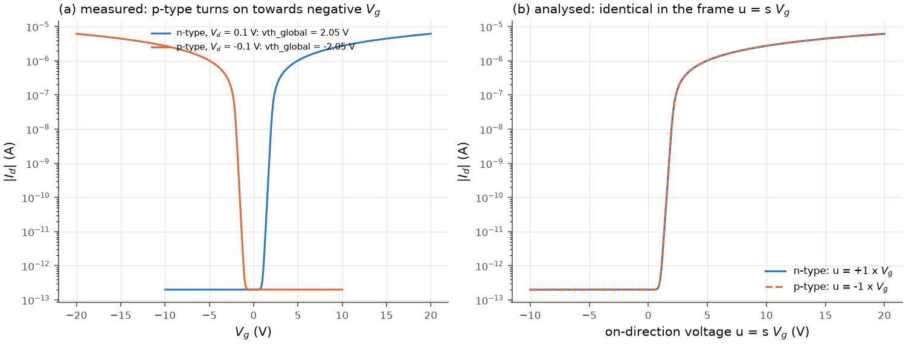

# Polarity, units and sweeps

## Units

| quantity | unit | where |
|---|---|---|
| voltages V_g, V_d, V_th, Delta V_th | V | everywhere |
| currents I_d, I_g, I_on, I_off | A | |
| channel width W, length L | um | `Device(width_um, length_um, ...)` |
| gate-insulator thickness | nm | `gate_capacitance(eps_r, thickness_nm)`, `Device.from_dielectric` |
| gate-insulator thickness in `Conditions.xls` | um | `read_conditions` (as in the original scripts) |
| gate capacitance per area C_i | F/cm² | `Device.c_i` |
| transconductance g_m | S (A/V) | `gm_max` |
| mobility | cm² V⁻¹ s⁻¹ | `mu_*` |
| subthreshold swing | mV/dec | `ss` |
| interface-trap density D_it | cm⁻² eV⁻¹ | `d_it` |
| trapped-charge density N_trap | cm⁻² | `HysteresisResult.n_trap` |
| loop area | dec V | `HysteresisResult.loop_area` |
| temperature | K | `TransferSettings.temperature` |

C_i = eps_0 eps_r / t_i (`gate_capacitance`); 300 nm SiO2 (eps_r = 3.9) gives
11.5 nF/cm², 100 nm gives 34.5 nF/cm².

```python
dev = tiv.Device.from_dielectric(width_um=100, length_um=10, eps_r=3.9, thickness_nm=100, polarity="n")
dev = tiv.Device(width_um=100, length_um=10, c_i=3.45e-8, polarity="p")   # C_i known, F/cm^2
```

## Polarity

`Device.polarity` is `"n"` when |I_d| increases with increasing V_g (electron channel) and
`"p"` when it increases with decreasing V_g (hole channel). For ambipolar devices choose the
branch to analyse and select the corresponding V_g range.

With s = +1 (n) or -1 (p), every method works in the **on-direction frame**

$$u = s\,V_g \ (\text{ascending}), \qquad a = |I_d|,$$

in which the current increases with u for both polarities. A p-type curve is therefore
analysed like the mirror image of an n-type curve, and voltages are mapped back with
V = s u. Consequences:

* threshold voltages are reported in the measured V_g frame (typically negative for p-type);
* SS, g_m and all mobilities are positive for both polarities;
* `LineFit.slope` is in V_g coordinates (negative for a p-type current-vs-V_g line);
* V_d is signed (p-type devices are normally measured with V_d < 0); formulas use |V_d|,
  and the V_d/2 correction uses the signed value;
* a p-type curve and the exact mirror of an n-type curve (V_g, I_d, V_d -> -V_g, -I_d, -V_d)
  give exactly mirrored results when the interpolation grid needs no inserted points
  (tested); otherwise the inserted points are anchored at the lower-V_g end of each gap for
  both polarities, as in the original scripts ([interpolation](interpolation.md));
* ties between equal values (equally long subthreshold runs, equally good windows) are
  resolved towards the lowest V_g, as in the original scripts.



*(a) An n-type model curve and its p-type mirror as measured. (b) The same two curves in the
on-direction frame, where they coincide; the analysis reports +2.05 V and -2.05 V.*

## Sweeps and segments

A measured V_g sequence can contain several monotonic segments: a dual sweep -20 -> 20 ->
-20 V has two, a ramp 0 -> -30 V followed by -30 -> 40 -> -30 V has three.
`monotonic_segments(v_g)` returns their indices in measurement order (a turning point
belongs to both neighbouring segments; a repeated V_g value separates segments).

`analyze_transfer` analyses one of them, `TransferSettings.segment`:

* `-1` (default, the documented default of the original scripts): the longest segment, the
  first of equally long ones. For the three-segment sweep above this is the forward sweep
  -30 -> 40 V.
* `k >= 0`: the k-th segment in measurement order; a number that does not exist raises
  `CurveError`.

The on/off ratio is the exception: it uses every point of the curve. For forward/backward
comparisons use [`analyze_hysteresis`](hysteresis_and_traps.md).

## Errors and missing values

* `CurveError`: the curve cannot be analysed at all (fewer than 4 distinct V_g values, a
  constant V_g, a requested segment that does not exist, non-finite values).
* A quantity whose criterion is not met (no subthreshold region, I_crit never reached, V_d
  unknown, ...) is NaN, and `TransferResult.notes` says why. Nothing is replaced by a
  default value silently.
