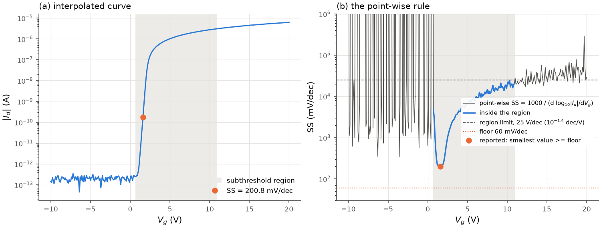
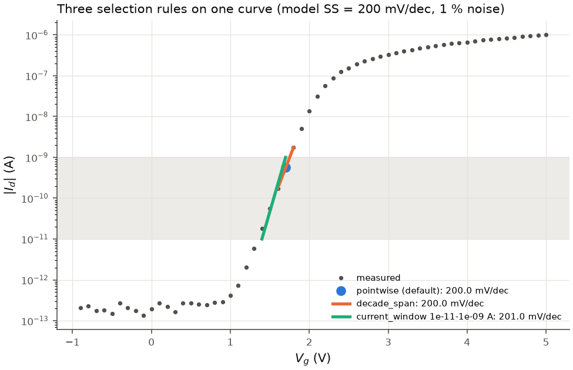
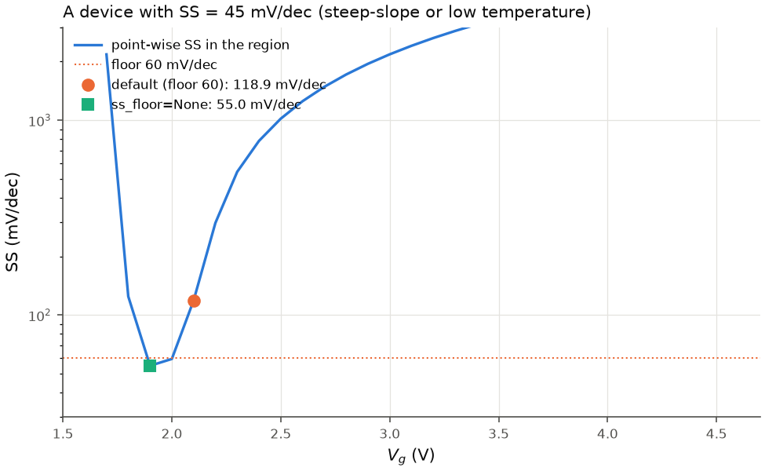

# Subthreshold swing

## Definition

$$SS = \left(\frac{d\log_{10}|I_d|}{dV_g}\right)^{-1} \quad \text{in mV/dec},$$

the gate-voltage change needed to change the drain current by one decade below
threshold, with the derivative taken in the on-direction (SS > 0 for both polarities).
The room-temperature thermionic limit of a conventional FET is
ln(10) k_B T / q = 59.5 mV/dec at 300 K (`thermal_ss_limit(T)`); the excess above it
measures the trap and depletion capacitance (see [D_it](hysteresis_and_traps.md#interface-trap-density-from-ss)).

Three selection rules are implemented. The default is the rule of the original
scripts.

| `TransferSettings.ss_method` | works on | SS is ... |
|---|---|---|
| `"pointwise"` (default) | interpolated curve | the smallest point-wise SS >= `ss_floor` (60 mV/dec) inside the subthreshold region |
| `"decade_span"` | measured points | the shortest V_g span over which the current envelope rises by `ss_decades` decades |
| `"current_window"` | measured points | 1000 / slope of a line fit of log10\|I_d\| vs V_g inside a stated current window |

## The subthreshold region

`subthreshold_region(curve, sensitivity)`: on the [interpolated curve](interpolation.md),
the longest run of consecutive grid points with

$$\frac{d\log_{10}|I_d|}{dV_g} \ge 10^{-\text{sensitivity}} \ \text{dec/V},$$

default `ss_sensitivity = 1.4`, i.e. 0.040 dec/V (a point-wise swing of at most
25 V/dec). A larger sensitivity widens the region. Of equally long runs the one at the
lowest V_g is taken. "Longest" counts grid points, not volts. The region is also used by
`vth_interpol` and `vth_logderivative`.

The criterion selects "where the current rises noticeably", which includes the lower
part of the on-state: above threshold in the linear regime the log slope is
1/[ln(10)(V_g - V_th - V_d/2)], above 0.040 dec/V up to about 11 V above threshold
(figure below, panel b). The off state is excluded only if its log slope stays below
0.040 dec/V; noise on a low current can exceed that (that is why the longest run is
taken).

## Point-wise rule (default)

`subthreshold_swing(curve, region, floor=60.0)`:

1. point-wise SS = 1000 / (d log10|I_d|/dV_g) at every grid point (`swing_curve`);
2. inside the region, keep the values >= `ss_floor` (default 60 mV/dec);
3. report the smallest of them, and its position (`TransferResult.swing.v_range`).

*(a) The interpolated curve of the noisy model device (model SS = 200 mV/dec), the region
and the reported point. (b) The point-wise SS: outside the region the off-state noise
gives meaningless values; inside, the minimum is at the steepest point of the
subthreshold characteristic (200.8 mV/dec here).*

The 60 mV/dec floor removes steeper values, which for a conventional FET at room
temperature can only be artefacts (noise, interpolation overshoot, a range change of the
instrument).

## Decade-span rule (option)

`ss_decade_span(v_g, i_d, polarity, decades=1.0, i_min=None, floor=None)`, selected
with `ss_method="decade_span"`:

1. log10|I_d| of the measured segment is median-filtered over 5 points;
2. only the branch from the current minimum towards the on-state is kept and replaced
   by its running maximum (the envelope), so that noise below the subthreshold region
   cannot mimic a steep slope;
3. among all spans over which the linearly interpolated envelope rises by `decades`
   decades and that start at or above `i_min` (default: ten times the
   [robust off level](transconductance_and_on_off.md#onoff-ratio)), the shortest one is
   taken; SS = span / decades. `ss_floor` applies here too (set `ss_floor=None` for none).

`SwingResult.v_range` and `i_range` give the span. Because it averages over a decade, it
is less sensitive to single noisy points than the point-wise minimum.

## Current-window rule (option)

`ss_current_window(v_g, i_d, polarity, i_low, i_high)`, selected with
`ss_method="current_window"` and `ss_current_window=(i_low, i_high)`: a least-squares line
of log10|I_d| vs V_g through the measured points with i_low < |I_d| < i_high (at least 4),
SS = 1000 / slope. The window is stated, not detected, so the result is reproducible and
comparable between devices; report the window with the value.

*The three rules on a model curve with 1 % noise: the point-wise minimum (dot), the
shortest decade (orange span) and the line fit in 10 pA to 1 nA (green). All three give
200 to 201 mV/dec here; on real curves they can differ by tens of percent.*

## Parameters

| `TransferSettings` field | default | used by |
|---|---|---|
| `ss_method` | `"pointwise"` | selects the rule |
| `ss_sensitivity` | 1.4 | region (point-wise rule, `vth_interpol`, `vth_logderivative`) |
| `ss_floor` | 60.0 mV/dec | point-wise and decade-span rules; `None` = no floor |
| `ss_decades` | 1.0 | decade-span rule |
| `ss_i_min` | `None` (10 x robust off level) | decade-span rule |
| `ss_current_window` | `None` | current-window rule (required there) |

## Pitfalls

* **The floor hides real sub-60 values.** Steep-slope devices (negative-capacitance,
  tunnel, impact-ionisation FETs) and measurements below room temperature have a genuine
  SS below 60 mV/dec. With the default floor the point-wise rule can only report values
  >= 60 mV/dec, and it reports the next value above the floor, which can be far from the
  true one. Use `ss_floor=None` (and `thermal_ss_limit(T)` for the temperature). This
  default is listed for the author's decision in [changes_from_original.md](changes_from_original.md).

  

  *A model device with SS = 45 mV/dec: the default reports 118.9 mV/dec (the smallest
  point-wise value >= 60), `ss_floor=None` reports 55.0 mV/dec (limited by the 0.1 V
  steps).*

* **The minimum of a noisy curve is biased low.** With exact interpolation the
  point-wise SS follows every noise fluctuation, and taking the minimum selects the most
  favourable one. Smooth the spline (`spline_smoothing`), use the decade-span or
  current-window rule, or report the region of the minimum.
* **The longest run can be in the on-state.** On noisy data single grid points of the
  subthreshold characteristic can fall below 0.040 dec/V and split it into short runs; the
  longest run is then a stretch of the on-state, and SS is meaningless (thousands of mV/dec).
  This happens in particular on the alternating 0.2/0.05 V grid of 0.25 V data. `analyze_transfer`
  adds the note `ss_on_state` when SS was taken above 1 % of I_on; then use `grid_step=None`,
  `ss_sensitivity`, or the decade-span or current-window rule. (A bundled example is listed in
  [changes_from_original.md](changes_from_original.md), D10.)
* **Exit from the noise floor.** A step from the noise floor into the subthreshold
  region (instrument range change, a single spike) can produce a very steep point-wise
  slope at the start of the region. Check `TransferResult.swing.v_range` against the plot.
* **Sampling.** With steps comparable to SS x 1 decade the swing is resolved by only a
  few points; the point-wise value is then an interpolation result.
* **D_it inherits all of this** ([hysteresis_and_traps.md](hysteresis_and_traps.md)).
