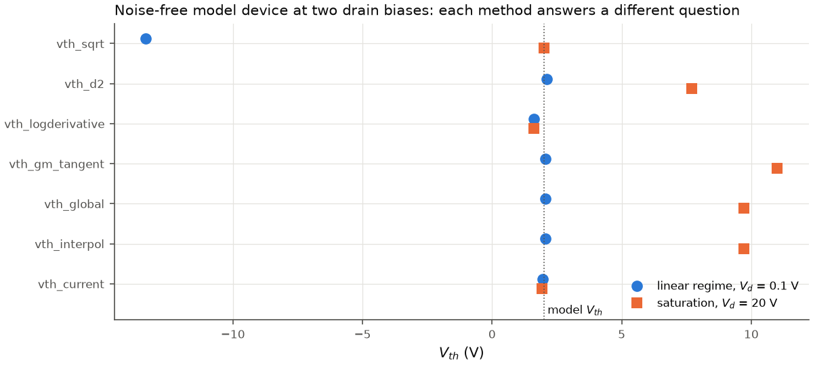
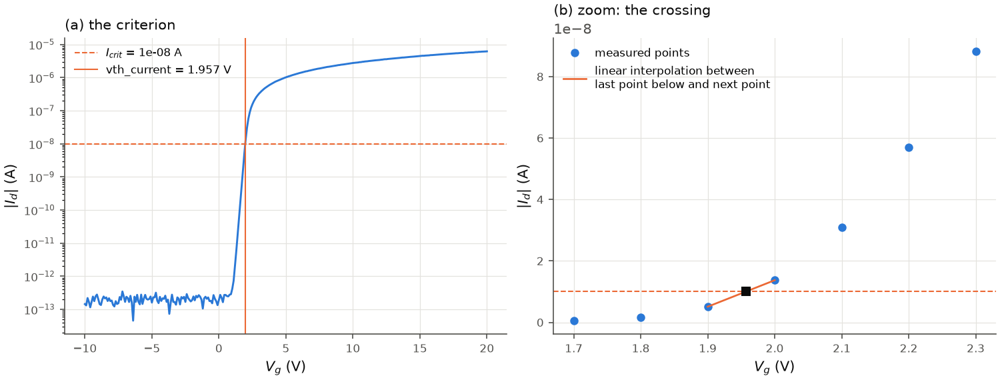
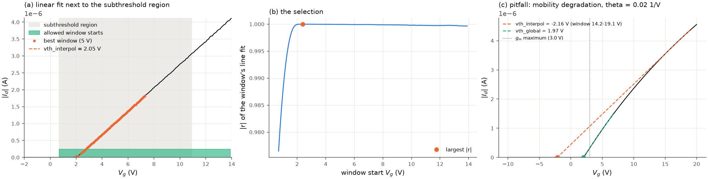
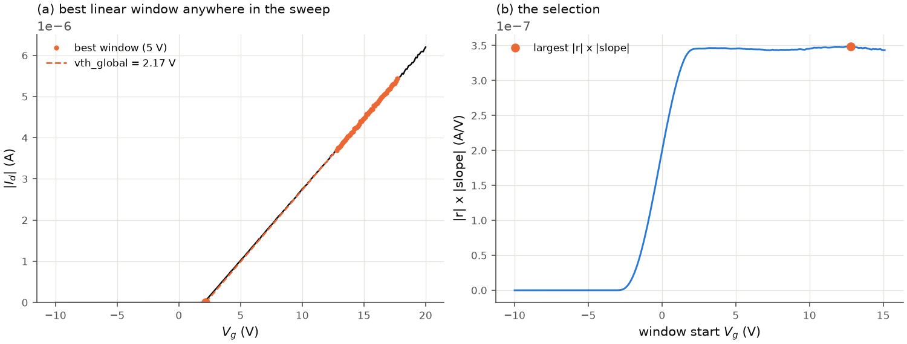
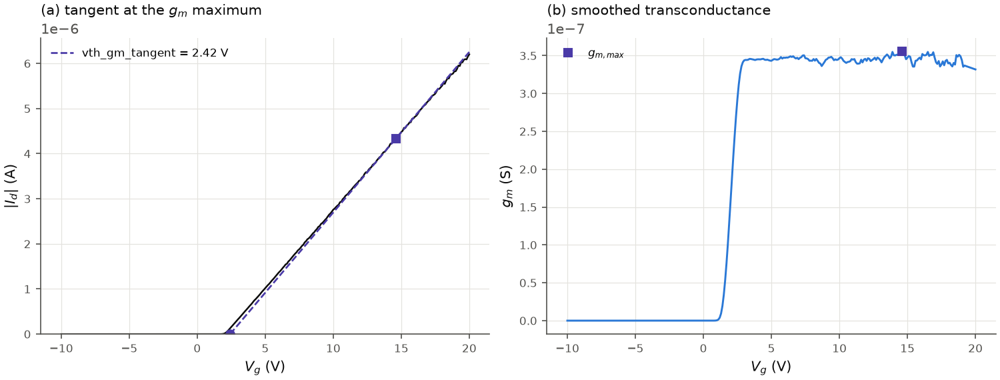
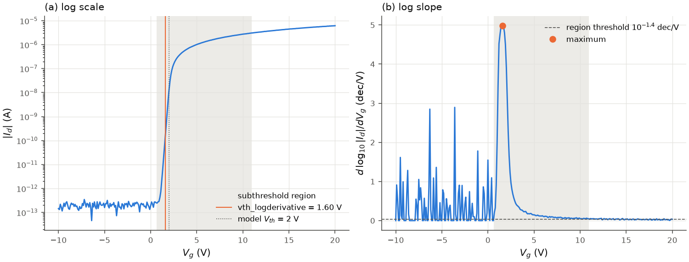
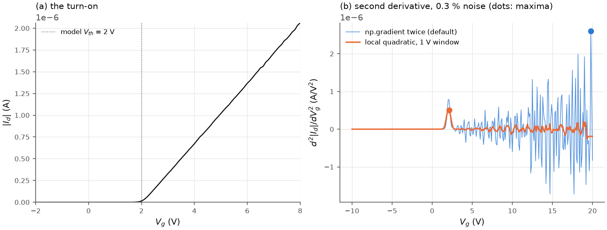
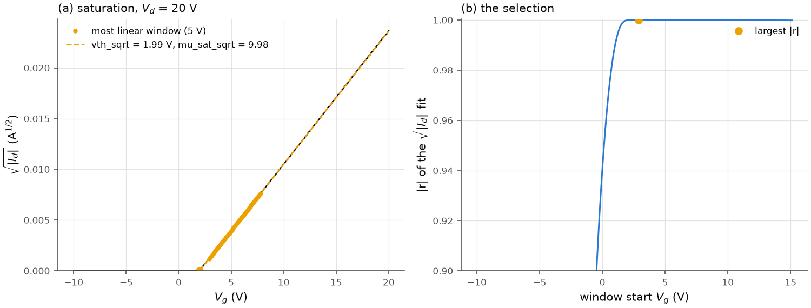

# Threshold voltage

`analyze_transfer` reports seven threshold voltages. Six are the methods of the
original analysis scripts (the result names are kept); `vth_gm_tangent` is the
textbook linear extrapolation at maximum transconductance, added for comparison.
Every value is in volts, in the measured V_g frame (negative for a typical p-type
device; see [polarity and units](polarity_and_units.md)).

| result field | method | works on | regime in which it is a threshold |
|---|---|---|---|
| [`vth_current`](#constant-current-vth_current) | V_g at \|I_d\| = I_crit | measured points | any (a convention) |
| [`vth_interpol`](#linear-fit-next-to-the-subthreshold-region-vth_interpol) | intercept of the most linear 5 V window of I_d, starting in the subthreshold region | interpolated curve | linear |
| [`vth_global`](#best-linear-window-vth_global) | intercept of the 5 V window maximising \|r\| x \|slope\| | interpolated curve | linear |
| [`vth_gm_tangent`](#tangent-at-maximum-g_m-vth_gm_tangent) | intercept of the tangent at the g_m maximum | interpolated curve | linear |
| [`vth_logderivative`](#maximum-log-slope-vth_logderivative) | V_g of the steepest log slope | interpolated curve | none: a subthreshold marker |
| [`vth_d2`](#second-derivative-vth_d2) | V_g of the maximum of d²I_d/dV_g² | interpolated curve | linear |
| [`vth_sqrt`](#square-root-extrapolation-vth_sqrt) | intercept of the most linear 5 V window of sqrt\|I_d\| | interpolated curve | saturation |

The "interpolated curve" is described in [interpolation.md](interpolation.md). The
figures use a synthetic n-type device (W/L = 100/10 um, 100 nm SiO2, model
V_th = 2 V, SS = 200 mV/dec, mu = 10 cm²/Vs, 0.3 % multiplicative noise) generated
with `transistor_iv.synthetic`; scripts in [`figures/`](figures/).

*The seven values for the noise-free model device in the linear regime (V_d = 0.1 V,
circles) and in saturation (V_d = 20 V, squares). In the linear regime the
linear-extrapolation methods and the second derivative agree with the model V_th
(their intercepts lie at V_th + V_d/2 = 2.05 V, see [the V_d/2 correction](#the-v_d2-correction-option));
in saturation only `vth_current`, `vth_sqrt` and `vth_logderivative` stay near it.
`vth_sqrt` of the linear-regime curve lies outside the sweep: the square-root method
has no meaning there.*

## Constant current (`vth_current`)

**Definition.** The gate voltage at which |I_d| equals a chosen current I_crit
(`TransferSettings.i_crit`, default 1e-8 A = 10 nA).

**Algorithm** (`vth_constant_current`). On the measured points of the analysed
segment, ordered in the on-direction, take the last point with |I_d| < I_crit and
the point after it, and interpolate V_g linearly in |I_d| between the two
(`cc_interpolation="log"` interpolates in log10|I_d| instead). Taking the last
crossing makes an elevated current at the off end (leakage, ambipolar branch)
harmless.

*(a) The criterion on the log scale. (b) The two measured points that bracket
I_crit and the linear interpolation between them.*

**Valid** in any regime: it is a convention, not a property of a device model.
Comparisons between devices need the same I_crit, or a geometry-normalised one such
as I_crit = 10 nA x W/L (set `i_crit` per device).

**Pitfalls.** The value moves with I_crit by SS x (decades of change); a criterion
inside the noise or leakage level raises `ExtractionError` ("never drops below") or
picks a noise crossing; with coarse steps the linear interpolation of an exponential
is biased (use `cc_interpolation="log"`).

## Linear fit next to the subthreshold region (`vth_interpol`)

**Definition.** The V_g-axis intercept, -b/m, of a straight line I_d = m V_g + b
fitted to the most linear `linear_window`-wide (5 V) stretch of the interpolated
curve that starts in or just above the subthreshold region.

**Algorithm** (`vth_linear_ss_window`).

1. Find the [subthreshold region](subthreshold_swing.md#the-subthreshold-region):
   grid indices [start, end].
2. Candidate windows: n = floor(5 V / mean grid spacing) consecutive grid points
   (at least 3), with the first point between `start` and
   `end + floor(3 V / mean spacing)` (`linear_extension`, towards the on-state), and
   ending before the end of the sweep.
3. Fit every candidate with least squares and keep the one with the largest |r|
   (Pearson correlation coefficient; of equal ones the one at the lowest V_g).
4. V_th = -b/m of that line. If no full window fits before the end of the sweep, the
   remaining points from `start` are fitted.

*(a) The subthreshold region (shaded), the allowed window starts (bar), the chosen
window and its extrapolation. (b) |r| of every candidate: on this curve (constant mobility)
the most linear window starts just above turn-on. (c) The same device with mobility
degradation, mu / (1 + theta (V_g - V_th)) with theta = 0.02 1/V: the curve is concave, the
most linear window lies far in the on-state and the intercept is -2.2 V, while `vth_global`
stays at 2.0 V.*

**Valid** in the linear regime (|V_d| much smaller than V_g - V_th over the window), on
curves with a straight part just above threshold. The point-wise mu_eff and mu_sat use this
value by default (`mobility_vth`, see [mobility](mobility.md)).

**Pitfalls.** *Concave curves.* With mobility degradation (or contact resistance) the curve
bends down above threshold; the most linear window is then a nearly straight stretch high in
the on-state, and its intercept lies far below V_th: on the model device -0.3 V, -2.2 V and
-6.5 V for theta = 0.01, 0.02 and 0.05 1/V (V_th = 2 V), panel (c). `analyze_transfer` adds the
note `vth_interpol_window` when the window starts above the g_m maximum; compare with
`vth_global` and `vth_gm_tangent`. (Listed for the author's decision in
[changes_from_original.md](changes_from_original.md), D9.)

*Wide region.* The region criterion (0.040 dec/V) is not strictly subthreshold: in the
linear regime the log slope above threshold is 1/[ln(10)(V_g - V_th - V_d/2)], which
stays above 0.040 dec/V up to about 11 V above threshold, so the windows can start
well into the on-state (panel a). Near-linear stretches differ in |r| only in the
fifth decimal, so on noisy data the chosen window, and the intercept, can jump. On
curves without a straight part (2D-material FETs whose current is convex up to the
end of the sweep) the intercept depends on where the sweep ends.

## Best linear window (`vth_global`)

**Definition.** The intercept of the line through the 5 V window, anywhere in the
sweep, that maximises |r| x |slope| (slope in A/V).

**Algorithm** (`vth_best_linear_window`): fit every window of n consecutive grid
points (as above), score = |r| |m|, take the maximum, V_th = -b/m. It does not use the
subthreshold region, so it works when that region is not found.

*(a) The chosen window and its extrapolation. (b) The score of every window start:
steep and straight windows win, i.e. the linear part near maximum g_m.*

**Valid** in the linear regime. In practice close to the textbook extrapolation at
maximum g_m, averaged over 5 V.

**Pitfalls.** With mobility degradation the score peaks at the g_m maximum; with a
g_m that keeps rising (convex curves) at the end of the sweep, so the result depends on
the sweep range. In saturation it extrapolates a parabola and is meaningless (figure
at the top).

## Tangent at maximum g_m (`vth_gm_tangent`)

Addition, not in the original scripts.

**Definition** (the "extrapolation in the linear region" method of the
threshold-voltage literature):

$$V_{th} = V_{g,m} - \frac{I_d(V_{g,m})}{g_{m,max}},$$

the intercept of the tangent to I_d(V_g) at the gate voltage V_g,m of the
transconductance maximum.

**Algorithm** (`vth_max_gm_tangent`): g_m from [`transconductance`](transconductance_and_on_off.md)
(smoothed over `gm_window`, default 1.6 V), its maximum, the interpolated current
there.

*(a) The tangent at the g_m maximum (square). (b) The smoothed g_m and its maximum.*

**Valid** in the linear regime. **Pitfalls:** the maximum of a noisy g_m is biased
towards a noise peak (see [transconductance](transconductance_and_on_off.md)); the
tangent's intercept moves with it.

## Maximum log slope (`vth_logderivative`)

**Definition.** The gate voltage of the largest d log10|I_d|/dV_g inside the
subthreshold region, i.e. the point of the smallest point-wise swing.

**Algorithm** (`vth_max_log_slope`): argmax of the log slope of the interpolated
curve over the region.

*(a) The position on the log curve and the model V_th. (b) The log slope, the region
threshold 10^-1.4 dec/V and the maximum.*

**Validity.** This is the steepest point of the subthreshold characteristic, which lies
below the strong-inversion threshold. It is a reproducible turn-on marker, but not a
threshold voltage in the sense of the other methods. It is also different from the
"transconductance-to-current ratio" method, which takes the minimum (negative peak) of the
derivative of g_m/I_d. (This point is listed for the author's decision in
[changes_from_original.md](changes_from_original.md).)

**Pitfalls.** On a nearly exponential subthreshold region the log slope is flat and the
maximum is set by noise; a step or spike at the exit from the noise floor produces a
spurious maximum there.

## Second derivative (`vth_d2`)

**Definition.** The gate voltage of the maximum of d²|I_d|/dV_g², the "transconductance
change" dg_m/dV_g. For a square-law device in the linear regime the second derivative is
a peak (with a smooth subthreshold onset) centred at V_th + V_d/2.

**Algorithm** (`vth_second_derivative`): `np.gradient` applied twice to the
interpolated current (default, as in the original scripts), or, with
`d2_window = w` volts, the second derivative of local quadratic least-squares fits over
w volts (Savitzky-Golay of order 2 on a uniform grid). The maximum over the whole sweep
is taken.

*(a) The turn-on of the noisy model curve. (b) The second derivative without smoothing
(default) and with a 1 V window, with their maxima. With 0.3 % multiplicative noise the
unsmoothed maximum is a noise peak at the high-current end of the sweep (19.8 V); the
smoothed one is at 2.1 V, the grid point next to V_th + V_d/2 = 2.05 V.*

**Valid** in the linear regime with a well-defined turn-on.

**Pitfalls.** The most noise-sensitive method: a second derivative amplifies noise by
(step)^-2, and multiplicative noise grows with the current, so without smoothing the
maximum usually falls on noise in the on-state. Use `d2_window` (about 1 V for 0.1 V
steps), and compare with the other methods. The resolution is one grid step. In
saturation the second derivative of the square law is a plateau and the maximum is
ill-defined.

## Square-root extrapolation (`vth_sqrt`)

**Definition.** In saturation the long-channel square law gives

$$|I_d| = \frac{W C_i \mu}{2L}(V_g - V_{th})^2 \quad\Rightarrow\quad \sqrt{|I_d|} = \sqrt{\frac{W C_i \mu}{2L}}\,(V_g - V_{th}),$$

so sqrt|I_d| is a straight line with x-intercept V_th and slope b = sqrt(W C_i mu / 2L).

**Algorithm** (`vth_sqrt_extrapolation`): fit every 5 V window of sqrt of the
interpolated current, keep the largest |r|, V_th = -b0/b (b0 the line's intercept).
The slope gives `mu_sat_sqrt` = 2 L b² / (W C_i) (see [mobility](mobility.md)).

*(a) Saturation (V_d = 20 V): the most linear window and its extrapolation; the
recovered values are 1.99 V and 9.98 cm²/Vs for model values 2 V and 10 cm²/Vs.
(b) |r| of every window start.*

**Valid** only in saturation, |V_d| >= |V_g - V_th| over the fitted window
(`TransferSettings(diagnostics=True)` flags violations).

**Pitfalls.** In the linear regime the result has no meaning (figure at the top: far
outside the sweep). The most-linear criterion can pick a nearly flat part of the curve
(the off state or the top of a saturating current), giving intercepts tens of volts away;
check `TransferResult.fits["vth_sqrt"].v_range`. Devices whose current is quadratic in V_g
for other reasons (density-dependent mobility in 2D channels) give a straight sqrt|I_d|
also in the linear regime; the intercept is then a fit parameter, not the saturation
threshold.

## The V_d/2 correction (option)

In the linear regime of the square law, I_d = (W C_i mu / L)(V_g - V_th - V_d/2) V_d, so
a straight line through I_d(V_g) crosses zero at V_th + V_d/2 (signed V_d, grounded
source, both polarities). The original scripts report the intercept itself (default).
`TransferSettings(vd_correction=True)` reports intercept - V_d/2 for `vth_interpol`,
`vth_global`, `vth_gm_tangent` and `vth_d2` (whose peak also lies at V_th + V_d/2); the
function is `elr_correction(vth, v_d)`. The correction matters when |V_d| is not small:
at V_d = 10 V it is 5 V. It assumes the linear regime, which a large V_d does not satisfy
anyway.

## Choosing a method

* Report the method and its parameters with every V_th; values from different methods
  differ by volts on real devices.
* Linear regime (small |V_d|): `vth_global` (with or without the V_d/2 correction, stated);
  `vth_gm_tangent` and `vth_d2` (with `d2_window`) on low-noise curves only, since both use
  the maximum of a derivative; `vth_interpol` only after checking its window. Saturation:
  `vth_sqrt`.
* For comparing many devices or hysteresis shifts, `vth_current` is the most robust,
  provided I_crit lies well above the noise and in the same part of the curve for all
  devices.
* Inspect the fits: `TransferResult.fits[...]` holds every line (`v_range`, `r`), and
  `transistor_iv.plot.plot_analysis(result)` draws them.

## Parameters

| `TransferSettings` field | default | used by |
|---|---|---|
| `i_crit` | 1e-8 A | `vth_current` |
| `cc_interpolation` | `"linear"` (`"log"`) | `vth_current` |
| `linear_window` | 5.0 V | `vth_interpol`, `vth_global`, `vth_sqrt` |
| `linear_extension` | 3.0 V | `vth_interpol` (window starts up to this far past the region) |
| `ss_sensitivity` | 1.4 | the region used by `vth_interpol`, `vth_logderivative` |
| `gm_window` | 1.6 V (`None` = unsmoothed) | `vth_gm_tangent` |
| `d2_window` | `None` (unsmoothed) | `vth_d2` |
| `vd_correction` | `False` | `vth_interpol`, `vth_global`, `vth_gm_tangent`, `vth_d2` |
| `grid_step`, `spline_smoothing` | 0.2 V, 0 | every method except `vth_current` ([interpolation](interpolation.md)) |

## Functions

`vth_constant_current(v_g, i_d, polarity, i_crit, interpolation)`,
`vth_linear_ss_window(curve, region, window, extension)`,
`vth_best_linear_window(curve, window)`, `vth_max_gm_tangent(curve, gm)`,
`vth_max_log_slope(curve, region)`, `vth_second_derivative(curve, window)`,
`vth_sqrt_extrapolation(curve, window)`, `elr_correction(vth, v_d)`; all in
`transistor_iv.transfer`, see [api.md](api.md).

References: A. Ortiz-Conde et al., *A review of recent MOSFET threshold voltage extraction
methods*, Microelectron. Reliab. 42, 583 (2002); H.-S. Wong et al., *Modeling of
transconductance degradation and extraction of threshold voltage in thin oxide MOSFETs*,
Solid-State Electron. 30, 953 (1987).
