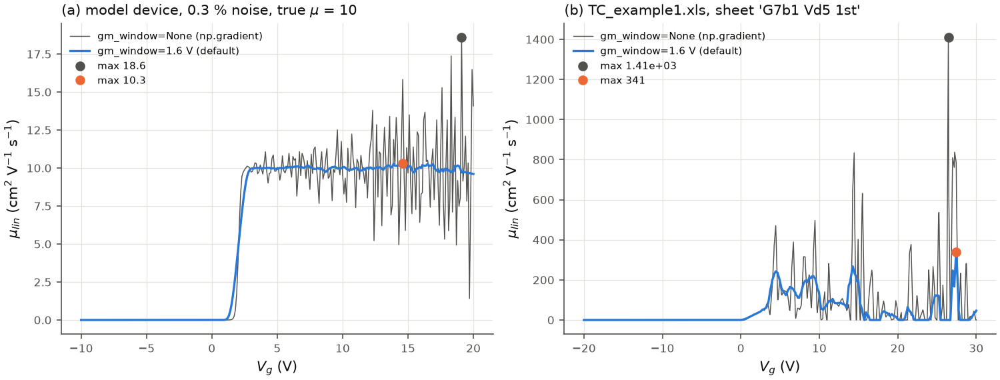
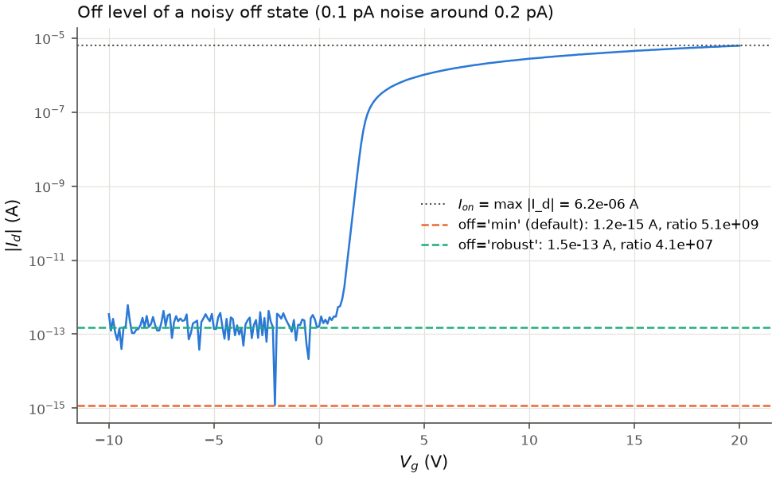

# Transconductance and on/off ratio

## Transconductance

**Definition.** g_m = d|I_d|/dV_g in the on-direction, in siemens (A/V); positive for
both polarities.

**Algorithm** (`transconductance(curve, window)`, on the [interpolated curve](interpolation.md)):

* `window = w` volts (default `gm_window = 1.6` V): the slope at each grid point of a
  local quadratic least-squares fit over the w-wide window around it (shifted inwards at
  the ends of the sweep). On a uniform 0.2 V grid this is the 9-point Savitzky-Golay
  derivative of order 2 (`scipy.signal.savgol_filter(i, 9, 2, deriv=1, delta=0.2)`);
  non-uniform grids are handled directly. The window must hold at least 5 grid points.
* `window = None`: `np.gradient` of the interpolated current (the numerics of the
  original scripts).

Negative values (current decreasing towards the on-state) are set to 0, as in the
original scripts. `TransferResult.gm_max` and `v_gm_max` are the maximum and its
position; `TransferResult.curves["gm"]` the whole curve; `gm_at(curve, gm, v_g)` reads
g_m at a stated gate voltage.

*Linear mobility mu_lin = L g_m / (W C_i |V_d|) from the unsmoothed and the smoothed g_m.
(a) Model device with 0.3 % multiplicative noise (true mu = 10 cm²/Vs): the maximum of
the unsmoothed curve is 18.6, of the smoothed one 10.3. (b) A measured oxide-TFT curve
with spiky on-currents (bundled `TC_example1.xls`): 1410 vs 341 (geometry from
`Conditions.xls`, SiO2 assumed).*

**Why smoothing is the default.** The maximum of a noisy derivative is a biased
estimator: it picks the largest noise excursion (panel a). This is fix B8 in
[changes_from_original.md](changes_from_original.md), where its effect on the bundled files
is listed; `gm_window=None` restores the original unsmoothed derivative.

**Choosing the window.** A wider window suppresses noise more but flattens a peaked g_m.
For 60 random model devices (V_th -3 to 3 V, SS 100 to 400 mV/dec, mu 1 to 50 cm²/Vs,
0.2 V steps from -20 to 30 V, V_d = 0.1 V; `study()` in `figures/make_mobility.py`):

| g_m shape | `gm_window=None` | 1.6 V (default) | 3.0 V |
|---|---|---|---|
| flat (constant mobility), 0.3 % noise | +61 % | +12 % | +5 % |
| peaked (mobility degradation theta = 0.05 1/V), no noise | -1 % | -4 % | -8 % |

*Median error of `mu_fe_max` relative to the true maximum of mu_lin.* The default 1.6 V
equals the 9-point Savitzky-Golay filter on 0.2 V steps.

**Pitfalls.** On a flat g_m plateau even the smoothed maximum is biased upwards by the
noise; for such curves report g_m (or mu) at a fixed V_g (`gm_at`) or averaged over a
range. On convex curves (g_m still rising at the end of the sweep, common in 2D-material
FETs) the maximum is the last point and depends on the sweep range.

## On/off ratio

**Definition.** I_on / I_off with, by default (original scripts),

* I_on = max |I_d| over **all** points of the curve (every sweep segment),
* I_off = the smallest positive |I_d| over all points,

from the measured data, so that the interpolation cannot overshoot
(`on_off_ratio(i_d, off="min")`).

**Option** `TransferSettings(off_level="robust")`: I_off = `robust_off_level(i_d)` =
10^median of the lowest 10 % of the 5-point median-filtered log10|I_d| values, which a
single noise dip cannot lower.

*A noisy off state (0.1 pA noise around 0.2 pA leakage). The smallest |I_d| is a noise
sample close to zero current (1.2 fA), which inflates the ratio by two orders of
magnitude compared with the robust level.*

**Pitfalls.** When the off state is at the instrument's noise floor, I_off and the ratio
describe the instrument, not the device; say so, or report I_off with its range setting.
I_on depends on the largest V_g of the sweep; compare devices at the same V_g and V_d.
In a dual sweep both branches enter.
